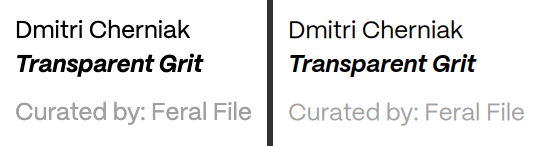

# FF1 display and controls

The comparison target is [shipping ff-player 3.0.1](https://github.com/feral-file/ff-player/tree/978266e9b62109ae3ae52b4221df67e71c84bc39). The FF1 host and all artwork workers live under `components/feral-display`. The host receives controld's commands, manages playback and draws device UI. Cage presents their Wayland surfaces.

| Operation | Owner and behavior |
| --- | --- |
| Fit and fill | The host resolves the authored display settings, per-field permissions, per-occurrence adjustment and saved framing choice. The libmpv worker applies those settings to images and videos. Fit preserves the full frame with a matte. Fill crops at the center. |
| Display rotation | Controld persists the mount orientation and changes Cage's output transform. This rotates the picture, pointer and labels together. The workers still honor image EXIF and video orientation metadata. |
| Tombstone | The host uses the bundled PP Mori faces for artist, bold italic title and optional curator. Always-on and timed modes use the shipping bottom-left plaque. The timed mode includes a countdown. |
| QR and pairing | The host paints the dimmer, instructions and code over the artwork, including over a directly presented CEF surface. Setup owns its optional animated backdrop. A separate QR worker would duplicate lifecycle and focus handling. |
| Pointer | The host draws a notched yellow pointer with a charcoal edge. A press shortens the shape and adds a light ring at the same hotspot. Feedback lasts at least 200 ms for a quick click, and the pointer hides after five seconds of inactivity. The CEF Wayland relay observes physical input while delivering the event to the page. |
| Loading and failures | The host delays the loading label by two seconds, displays fatal playback errors fullscreen and keeps recoverable storage notices compact. After three failed retries it can advance to another eligible work, retaining a bound on all-failed playlists. |

The cursor design interprets Canon's [FF1 product intent](https://github.com/feral-file/canon/blob/main/reference/ff1-spec.md) around unobstructed daily art and interactive works. The shape and colors are specific to this implementation. Canon bundle build was 2026-11-20 05:07:46 UTC.

The FF1 build workflow produces a runtime archive, a SHA-256 manifest and a separate set of rendered UI fixtures. [Dependency pins and FFOS package checks](../README.md#ff1-runtime-ownership-and-upgrade-checks). The earlier [same-device media and browser measurements](CAGE-WORKERS.md) identify their own tested revisions and decoder limits.

## Qualification on homelab

GitHub Actions built `7c987a14` and passed all 19 CTest groups plus the Go/C++ controld interoperability suites. The FF1 archive matched its SHA-256 before and after transfer. Comparing the unpacked files to the archive succeeded, the sandbox helper was root-owned with mode 4755 and the three installed FFOS packages matched their version lock. The comparison Chromium job passed independently. [FF1 build](https://github.com/feral-file/ffos-user/actions/runs/44733579346) · [Runtime archive and SHA-256](https://github.com/feral-file/ffos-user/actions/runs/44733579346/artifacts/14627793104) · [CI UI rasters](https://github.com/feral-file/ffos-user/actions/runs/44733579346/artifacts/14627553555).

For the visual comparison, shipping React components and styles were rendered in headless Chrome with their bundled fonts and identical synthetic content. The native rasters came from the Linux CI archive. At 1920 × 1080, the always-on plaque measured 267 × 146 pixels in both renderers. Each edge of the white claim and Wi-Fi QR frames was within one pixel of the reference at 1920 × 1080, 1080 × 1920, 1920 × 1920 and 3840 × 2160. All eight native payloads decoded and matched the corresponding shipping payload. The four visible lines of the 1080p mint pairing code screen had the same breaks. Their top and bottom ink bounds differed by up to two pixels. Native Pango/Cairo and Chromium rasterize glyphs differently. These measurements cover one representative label and the stated screens.

Shipping plaque on the left and native plaque on the right.

Moving and pressed poses, enlarged from the actual FF1 cursor raster.

The device tests started with signed FF-CLI casts to homelab. A saved framing command went through the paired controller. Cage captures of a wide PNG and H.264 color-bar clip showed both outer bands and a black matte in fit, and only the center color across the output in fill. A playlist that locked scaling retained its authored fit when the saved preference changed to fill. A 32-pixel-wide stripe fixture enlarged to 1920 pixels produced two exact intensities in glycin. H.264 stayed within one level of those two intensities. Controller rotation updated both the persisted orientation and live Cage transform from normal to 270° and back.

A direct CEF page changed background on pointer-down and used a separate color for a duplicate event. The controller click and the Linux input-device injection each produced the single-click color on a fresh page. The host's moving and pressed rasters appeared over the page, and the pointer cleared after idle. The QR payload also decoded from the live square Cage output.

Both sustained Big Buck Bunny HEVC runs used VA-API. In 60.72 seconds per clip, Radeon decoder time advanced 12.42 seconds for 2160p Main and 4.81 seconds for Main10. Both added zero decoder and output drops. All eight format/container variants reached direct presentation and displayed changing pixels. Seven used VA-API. The 4:4:4 Range Extensions sample used software.

All 13 entries in the original *Unsupervised* playlist reached Cage presentation. Nine used glycin and four used libmpv. Three H.264 works used VA-API. *Data Universe* used software for its 4096 × 4096 AVC stream. A compositor capture also showed the always-on plaque over that work. The run finished on the original signed playlist, awake, with the normal output transform and the legacy service inactive. The FF1 retained the same boot ID through this qualification. [Measurements](evidence/ui-parity-20261120/results.json) · [PNG and H.264, fit and fill](evidence/ui-parity-20261120/framing.png).

The fresh completion review accepted the saved-matte and offline-recovery fixes and the plaque geometry regression. Earlier accelerated runs on this device ended in three unexplained reboots. This short qualification did not establish unattended stability or full-portfolio equivalence. The screen observations are Cage captures. Physical panel and overnight acceptance remain open.
