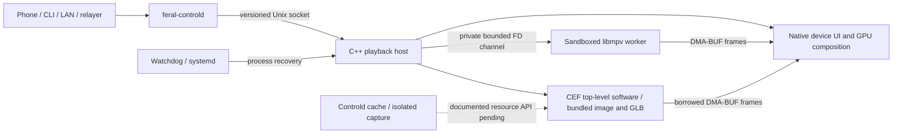

# Native player architecture and ownership

Implementation is in progress. This describes the intended boundaries and calls
out incomplete migration; it is not an activation or acceptance declaration.

## Authority

Controld owns controller authentication/authorization, provisioning/pairing,
device operations, source fetching and verification, cache mutation/capture and
external compatibility. Host commands are typed playback/presentation actions;
no arbitrary evaluation or old `handleCDPRequest` envelope crosses the socket.
The external phone/CLI contract remains controld's adapter responsibility.

The C++ host owns selected and presented occurrences, playlist progression,
timers, shuffle/loop/EOS, playback persistence, input state, renderer lifetime,
native labels/errors/loading UI, composition and command outcomes. Its SQLite
transaction commits durable intent before an operation is admitted. Renderer
readiness and presentation do not survive restart. Restarted processes receive
new instance IDs; repeated URLs receive distinct occurrence IDs.

The host is the sole playlist schedule executor. Controld may resolve and refresh
source documents and continues owning device sleep schedules, but it must not
also run competing playlist timers after migration. The old scheduler/session
consumers are still being replaced; do not deploy the partial controld diff.

Watchdog/systemd own host termination, GPU failure escalation, resource pressure
and device reboot policy. Host recovery is limited to three renderer replacements
at 1/2/4 seconds. Brief successful frames do not replenish that budget; explicit
selection or 60 seconds presented does. Sleep/stop cancels pending retries.
The host never claims to survive its own death or a wedged shared GPU.

## Presentation and isolation

Software loads at its original top-level URL, with ordinary browser TLS, origin,
CSP and frame policies. Artwork navigation cannot replace the command server,
database or native device UI. Popups, downloads, context menus and permissions
are denied. Artist pages receive no injected label, cursor or control bridge.
Remote debugging is an optional diagnostic path and is not product control.

Each artwork browser gets a fresh, non-shared request context. This isolates
storage but does not promise a dedicated renderer process. CEF can share browser,
renderer and GPU failure domains. The software and bundled-renderer contexts do
not share resource factories. Only the bundled image/GLB document has a narrow
configuration/ready/error bridge; it cannot choose playback or attest trust.

GLB uses the same pinned model-viewer 4.3.1 bundle as the audited legacy player.
Its camera controls, animation autoplay, exposure and shadows are retained. The
default Draco/Basis decoder versions are locally packaged and hash-checked. The
bundled policy permits the pinned Basis worker's generated JavaScript wrappers;
that policy never changes artist response headers. Local-network permissions
remain denied; cache delivery must use the documented resource boundary, not an
unrestricted permission grant for model subresources.

Direct audio/video runs through libmpv in a separate bubblewrap worker with no
playback database, home, control socket, D-Bus or general mpv command interface.
Its bounded inherited socket transfers typed observations and GPU buffer handles.
The decoder cannot advance a playlist. The host handles EOS and fences every
observation to its occurrence. Worker faults are contained; shared GPU/driver
faults still require external recovery.

Borrowed CEF buffers are consumed during their callback. The normal path imports
DMA-BUFs, performs one GPU copy into host-owned storage and completes the copy
before releasing borrowed resources. It never reads pixels back to the CPU.
Mesa's implicit fences order the GPU read after the producer; `glFinish` completes
our copy before CEF reuses the buffer. Poll-and-drop is not used: it starved busy
WebGL artwork. This is not a missing-fence repair for NVIDIA (CEF #4313).

Host control, drawing and shutdown run as scheduled CEF UI tasks. They do not
wait for `CefDoMessageLoopWork` to drain until idle, which continuous accelerated
paint callbacks can prevent. A phase-preserving clock sends at most 60 external BeginFrames per second to
Chromium. Each artwork admits at most one copy between host turns; surplus
callbacks retain no resources and request one refresh on the next turn, including
for static documents. A fresh frame after renderer readiness is still required
for presentation admission. GPU copies can block on a driver/GPU failure: the
external watchdog must recover that shared process boundary. CPU painting is
diagnostic-only. Frame pacing, rotation and the complete failure boundary remain
subject to portfolio/hardware qualification; see BENCHMARK.md for the measured
Transparent Grit regression.

Native SDL/Pango/QR presentation sits outside artwork DOMs. The host owns one
pointer, held-key/button state and focus target, converts output pixels to artwork
coordinates, and releases state against the old target before destruction or
disconnect. UI rendering, rotation, transitions and display hotplug remain under
active verification; the current frame path is qualified only for short tests at
rotation 0 and scale 1.

## Outcomes and remaining migration

`selected`, navigation `committed`, and host `presented` are distinct. A command
receipt says accepted/applied, never that arbitrary art rendered correctly. A
host swap is composition evidence, not a panel photograph. The outgoing
occurrence retains its own playlist metadata while its replacement loads. If it
fails, it is retired and reported separately without charging the incoming
selection's recovery budget. Status/history use occurrence identity, not URL.

Status polling and setup narration now use the native socket. The host implements
durable source refresh; its external refresher adapter is still pending. Normal
command routing, mint pairing, session recovery, screenshots, offline replay and
watchdog/session activation remain incomplete. The old runtime is intentionally
retained for rollback/testing until those paths are verified together. This is a
development migration boundary, not permanent dual ownership or an implicit CDP
fallback. Full-image activation, release declarations and promotion instructions
must land in the owning FFOS repositories before rollout.

The offline design and the legacy response-metadata gaps are recorded in
OFFLINE.md. Existing cache coverage must not be advertised as native offline
readiness before the resource/capture boundary is implemented and verified.

Composition submits only changed artwork, changed host state, geometry/exposure,
cursor motion/expiry, or label expiry. It uses a nonblocking Wayland swap; Cage
owns vsync. A skipped composition does not acknowledge presentation to playback
or the media worker. Host socket/timer work runs independently at a bounded
4 ms polling interval. The optional Wayland presentation-time collector has a
bounded outstanding-feedback set and dispatches its own event queue on the host
thread. Its timestamps distinguish compositor output from renderer rAF timing;
see `PACING.md` for measured tradeoffs and limits.
